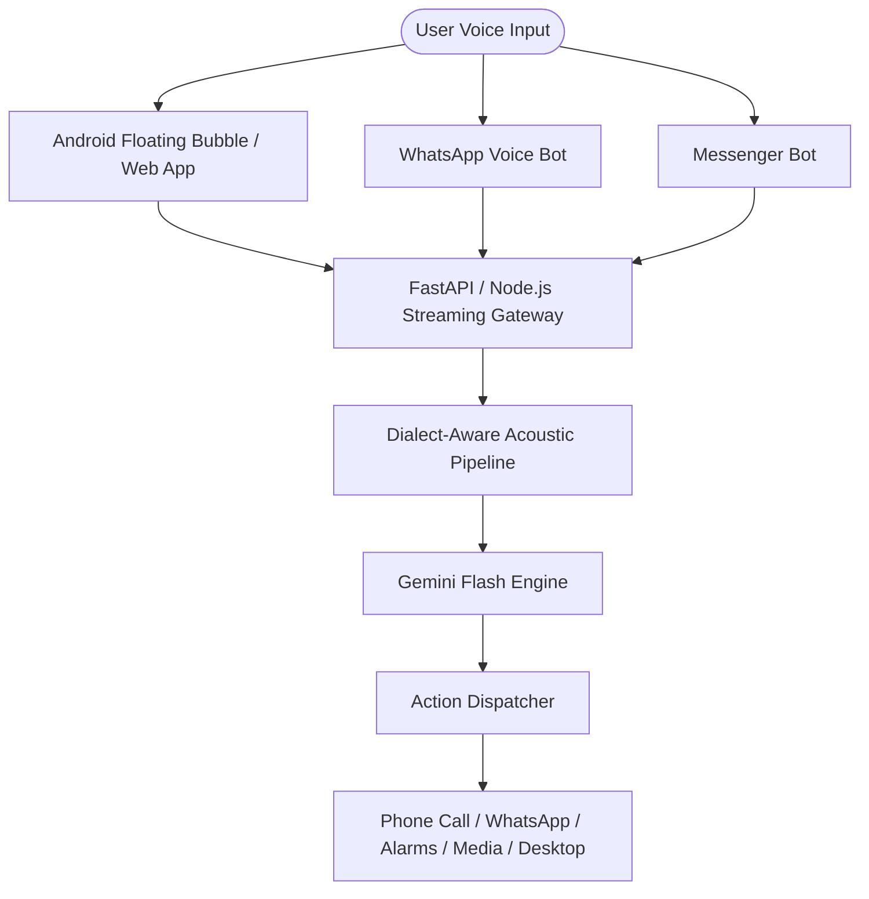

<div align="center">
  

  [](https://developer.mozilla.org/en-US/docs/Web/API/Web_Speech_API)
  [](https://tailwindcss.com/)
  [](https://ai.google.dev/)
  [](LICENSE)
</div>

---

# 🎙️ Shono AI (শোনো এআই) // The Unlimited Bangladeshi Jarvis
> **Bangladeshi Dialect-Aware Acoustic Pipeline, Architectural Blueprint & Futuristic HUD Interface**

"Shono AI" is designed as the first voice assistant engineered to understand and fluently converse across all major regional dialects of Bangladesh (Sylheti, Chatgaya, Noakhailla, Barisailla, Rangpuri, Dhakaiya, and Standard Bengali) as well as English.

---

## 🌌 System Architecture



---

## 🎨 Interactive Cyberpunk HUD Features

* **3D Audio Visualizer Orbit:** Circular real-time soundwave reacting to vocal input.
* **Dialect Classifier Visualizer:** Visual badges indicating detected regional accent and language nuance.
* **Instant Action Widgets:** Quick cards for weather, news, system diagnostics, and communication shortcuts.

---

## ⚡ Quick Start

Simply clone the repository and open `index.html` in any modern web browser to experience the interactive HUD.

```bash
git clone https://github.com/monisharani333022-eng/Shono-AI-Bangladeshi-Jarvis.git
cd Shono-AI-Bangladeshi-Jarvis
# Open index.html in your browser
```

---

## 👤 Author

* **Developer:** [Jubayer Ahmad](https://github.com/monisharani333022-eng)
* **Email:** [monisharani333022@gmail.com](mailto:monisharani333022@gmail.com)
* **Location:** Dhaka, Bangladesh 🇧🇩

---

## 📄 License

Distributed under the MIT License.
