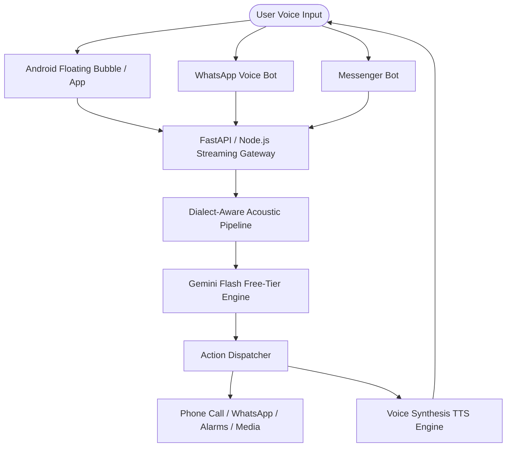

# Shono AI (শোনো) — Technical Architecture & Implementation Blueprint

## 1. System Overview
"Shono AI" is a Bangladeshi Jarvis-style voice assistant engineered to understand and converse across all regional dialects of Bangladesh (Sylheti, Chatgaya, Noakhailla, Barisailla, Rangpuri, Dhakaiya, and Standard Bengali) as well as English, with a future path for global multilingual support.



---

## 2. Android Client Layer (Floating Jarvis HUD)
- **Overlay Window**: Implemented via Android `SYSTEM_ALERT_WINDOW` permission with a draggable `WindowManager.LayoutParams.TYPE_APPLICATION_OVERLAY` view.
- **Audio Capture**: `AudioRecord` configured at 16kHz/48kHz PCM Mono, feeding into a WebSocket stream.
- **Foreground Service**: Keeps the hotkey listener alive in the background without getting killed by Android battery optimization.
- **Intent Dispatcher**: Executes local phone actions:
  - `Intent.ACTION_CALL` or `Intent.ACTION_DIAL` for phone calls.
  - `AlarmClock.ACTION_SET_ALARM` for alarms & reminders.
  - `Intent.ACTION_VIEW` for opening YouTube/Spotify/Maps.

---

## 3. Zero-Cost / Free-Tier Backend Pipeline
To honor the zero-budget constraint ("টাকা-পয়সা নাই"):
1. **Server Hosting**: 
   - Deploy backend on **Render.com** or **Hugging Face Spaces** (Docker free-tier, 100% free with SSL).
2. **AI Intelligence & Dialect Processing**:
   - **Gemini 1.5/2.0 Flash Free Tier API**: High rate limits (15 RPM / 1M TPM free), native multimodal audio comprehension, and strong semantic understanding of regional phonetic variations.
3. **Dialect System Prompt Engine**:
   - Injects phonetic mappings and colloquial grammars so the LLM effortlessly parses regional slang into actionable JSON intents.

---

## 4. Omnichannel Integration
- **WhatsApp**:
  - Connect via WhatsApp Cloud API webhook.
  - When user sends a voice note (`.ogg`), download media -> stream to Gemini audio endpoint -> return synthesized voice reply.
- **Facebook / Instagram**:
  - Meta Webhook receiver for page inboxes.

---

## 5. Directory Structure
```text
scratch/shono_ai/
├── index.html                  # Interactive Futuristic Jarvis Web Prototype
├── architecture_spec.md        # This technical blueprint
├── backend/                    # Python FastAPI / Node streaming server (Phase 2)
│   ├── main.py
│   ├── dialect_engine.py
│   └── requirements.txt
└── android/                    # Android Floating Bubble App (Phase 2)
    ├── app/
    └── build.gradle
```
